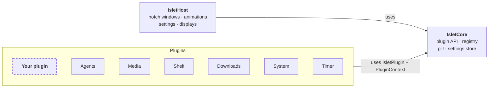

<div align="center">


# Islet

**Your MacBook's notch, finally pulling its weight.**

Islet turns the notch into a home for small, glanceable tools. Every screen is a plugin, and a simple one takes a few lines of SwiftUI. Islet ships with four ready-made plugins and a minimal example, and the next one is yours to build.

<a href="#-getting-started"></a>
<a href="https://www.swift.org"></a>
<a href="#-build-your-own-plugin"></a>
<a href="#-private-by-design"></a>

[Why Islet](#why-islet) · [Build a plugin](#-build-your-own-plugin) · [Built-in plugins](#-built-in-plugins) · [Getting started](#-getting-started) · [Architecture](#-architecture) · [FAQ](#-faq)

<br>


</div>

<br>

## Why Islet?

The notch sits in the most valuable spot on your screen and does nothing. Islet makes it a quiet status bar that grows into a full panel when you hover over it, and lets you decide what lives there.

- 🧩 **Everything is a plugin.** The built-in screens use exactly the same public API as yours. Nothing is special-cased.
- ⚡️ **One class and a SwiftUI view.** No window or AppKit code required, no private APIs. Islet handles the notch shape, hover, animations, displays and settings for you.
- 🎁 **Useful out of the box.** A control centre for coding agents, a music player, a file shelf and download progress ship as ready-made plugins, and double as reference implementations.

- 🎁 **Useful out of the box.** A control centre for coding agents, a music player, a file shelf and your GitHub pull requests ship as ready-made plugins, and double as reference implementations.
- 🪄 **Feels like part of macOS.** Smooth animations, a collapsed status pill, every display, a settings tab per plugin. Your plugin gets all of it for free.

<br>

## 🧩 Build your own plugin

A plugin is one class plus a SwiftUI view. This is a complete clock for your notch:

```swift
import IsletCore
import SwiftUI

@MainActor
public final class ClockPlugin: IsletPlugin {
    public static let manifest = PluginManifest(
        id: "com.example.clock",
        displayName: "Clock",
        systemImage: "clock"
    )

    private let context: PluginContext

    public init(context: PluginContext) {
        self.context = context
    }

    public func activate() async throws {
        context.contentSize = CGSize(width: 320, height: 120)
    }

    public func makeScreen() -> AnyView {
        AnyView(
            TimelineView(.periodic(from: .now, by: 1)) { timeline in
                Text(timeline.date, style: .time)
                    .font(.system(size: 44, weight: .semibold, design: .rounded))
                    .frame(maxWidth: .infinity, maxHeight: .infinity)
            }
        )
    }
}
```

### What your plugin gets

Every plugin receives a `PluginContext`, its single connection to the host:

| | |
|---|---|
| 📐 **`contentSize`** | Grow or shrink the notch to fit your content, animated. |
| 💊 **`pillStatus`** | Show text, an icon, a status ring or artwork in the collapsed notch, with a priority so urgent things always get through. |
| 📣 **`announce(_:)`** | Flash a short message below the collapsed notch. |
| ⚙️ **`settings`** + **`makeSettingsView()`** | Persist preferences and get your own tab in the settings window. |
| 📥 **`acceptsFileDrops`** | Let the notch react when files are dragged onto it and switch to your plugin; your view handles the drop. |
| 🔄 **`derive`**, **`observe`**, **`isScreenVisible`** | Keep the size and pill in sync with your model, react to changes, and pause work while your screen is hidden. |
| 🗂 **`storageDirectory`**, **`logger`** | A private folder for your data and an `os.Logger` scoped to your plugin. |

### From idea to notch in minutes

- **With Claude Code:** the repository ships a `/new-plugin` skill. Describe your idea and it scaffolds the package, the plugin class, the screen and a test target, registers the plugin with the app, then builds and tests it.
- **By hand:** create a Swift package that depends on `IsletCore`, add it to `project.yml` and list your class in `AppDelegate.builtInPlugins`. The [getting started guide](docs/plugins/getting-started.md) walks through every step.
- **From an example:** `Plugins/HelloPlugin` is a minimal plugin that resizes the notch, sets the pill and has its own settings tab. Copy it and start from there.

📖 The **[plugin developer guide](docs/plugins/README.md)** covers the full API, sizing, the collapsed pill, settings and storage, resources, concurrency and testing.

### 💡 Ideas for your notch

Pomodoro timer · next meeting from your calendar · CI and pull request status · clipboard history · smart home toggles · build progress for your dev server · a quick translator · stock or crypto ticker · world clocks for a remote team

<br>

## 🎁 Built-in plugins

Islet comes with four ready-made plugins, plus the minimal Hello example in Debug builds. They are ordinary plugins built on the same API as yours: use them as they are, switch off the ones you don't need, or read their source as examples.

### 🤖 Agents


A control centre for your coding agents. Islet installs lightweight hooks for **Claude Code** and **Codex** and shows every session live:

- **Approve without leaving your flow.** Permission requests and agent questions show up in the notch with **Allow** / **Deny** or the answer options.
- **Know what each agent is doing.** Working, needs you, finished or failed, with the current tool call, your last prompt, a turn timer and the recent tool calls when you expand a row.
- **Jump to the session.** One click brings the exact tab to the front in Terminal and iTerm2, the project window in VS Code, Cursor and VSCodium, and Ghostty, WezTerm, Warp, kitty, Alacritty, Hyper or Tabby when that's where the agent runs.
- **Remote machines.** Sessions on servers you reach over SSH show up too, labelled with the host name and flagged when the tunnel goes quiet.
- **Claude usage limits.** Your 5-hour and weekly quota and when each resets, read from Claude Code's own status line. Islet never reads your credentials or calls any API.
- **Alerts your way.** A sound, a macOS notification or a short announcement in the notch when an agent needs you or finishes.

### 🎧 Media


- Controls **Spotify** and **Apple Music**: play/pause, skip, shuffle, repeat and a seekable timeline.
- Browse your Apple Music playlists and start one right from the notch.
- The controls pick up their tint from the album artwork.
- Optionally shows the current artwork in the collapsed notch.

### 📥 Shelf


- Drag files onto the notch and Islet switches to the Shelf automatically.
- Drag them back out into any app, open them or reveal them in Finder.
- The Shelf survives restarts and dims files that were moved or deleted.

### ⬇️ Downloads

- Downloads in your Downloads folder show up in the collapsed notch: a ring that fills while one file downloads, or the number of downloads and their combined progress.
- Browsers that don't report progress show the file's name and growing size instead.
- A short announcement when a download finishes, and the last eight downloads in the notch, ready to drag into any app, open or reveal in Finder.

### 📊 System

- CPU, memory (with memory pressure) and network at a glance, each with a graph of its recent values, plus free disk space and the battery.
- The three processes using the most CPU right now.
- The closed notch stays quiet until something needs attention: sustained high CPU, memory pressure, a low battery, a hot Mac or an almost full startup disk, each announced once. Optionally shows a CPU ring all the time.
- Choose which rows to show under **Settings › System**. Samples every second while the screen is open and every five seconds otherwise.

### ⏱️ Timer

- Start countdown timers from presets (1, 5, 10 and 25 minutes) or any number of minutes, and pause, resume or cancel each one.
- The collapsed notch shows the timer ending soonest as a shrinking ring.
- When a timer ends, Islet plays a sound, announces it and shows an orange pill for a minute or until you open the Timer.
- **Pomodoro:** work and break phases with a red or green ring in the collapsed notch, a dot for each finished work phase, and a long break after every fourth. Durations and starting the next phase automatically are set under **Settings › Timer**.
- Timers keep running across restarts. A stopwatch is there too.

### 🐙 GitHub

- Your open pull requests and the ones waiting for your review, newest first, each with its review state and CI status.
- The collapsed notch shows a ring with the CI state of your pull requests, and turns orange when checks fail or someone requests your review.
- A short announcement when checks fail or pass, a pull request is approved or gets change requests, or someone asks for your review.
- Click a pull request to open it in the browser.
- Talks to GitHub only through the [GitHub CLI](https://cli.github.com) (`gh`), which keeps its own login. Refreshes every two minutes, every minute while you look at it, and pauses while you are offline.

<br>

## 🪄 The notch

### 💊 The pill


While collapsed, the notch grows a small pill next to the camera housing. Any plugin can put something there: a status ring, album artwork, a short text or an icon. Islet shows the most important one, and anything urgent always gets through.

### 🍎 Feels like part of macOS

- **Hover, click or a keyboard shortcut to open**, move away to close, with an adjustable delay. Swipe with two fingers or use the arrow keys to switch plugins.
- **Smooth ease-out animations** by default, or springs with adjustable bounce.
- **Four sizes** for the expanded notch.
- **Every display.** The built-in screen, the primary display, all displays or a specific monitor. Displays without a notch get a virtual one.
- **Menu bar icon** optional, **open at login** optional, and a settings window with a tab for each plugin. Plugins can be switched off one by one.

<br>

## 🔒 Private by design

| | |
|---|---|
| 🏠 **Runs on your Mac** | No accounts, no analytics, no Islet servers. The only outbound requests are the album artwork the Media plugin loads from Spotify's servers and the GitHub plugin's queries, which go through your own `gh` command-line tool. |
| 🔑 **No credentials** | Islet never touches your Keychain or API keys. Claude usage limits come from the data Claude Code already hands to its status line. |
| 📜 **Readable hooks** | The agent integration is a pair of small shell scripts in `~/.claude` / `~/.codex`, registered in `settings.json` / `hooks.json`, that talk to Islet over `127.0.0.1`. Read them, and remove them from the settings at any time. |
| 🎛️ **Opt-in** | Music control asks macOS for permission first; the agent hooks, macOS notifications and the status line integration are off until you turn them on. |

<br>

## 🚀 Getting started

**Requirements:** macOS 15 Sequoia or later, Xcode 26 or later and [XcodeGen](https://github.com/yonaskolb/XcodeGen). No Apple Developer account is needed; the app is signed locally.

```sh
brew install xcodegen
git clone https://github.com/MariSchn/Islet.git
cd Islet
xcodegen generate
xcodebuild -project Islet.xcodeproj -scheme Islet -configuration Release -derivedDataPath DerivedData build
open DerivedData/Build/Products/Release/Islet.app
```

Or open `Islet.xcodeproj` in Xcode and press <kbd>⌘</kbd> <kbd>R</kbd>. To keep Islet around, copy `Islet.app` to `/Applications` so **Open at login** keeps working after you clean the build folder.

**First launch:** hover over the notch, and that's it. Some built-in plugins need a one-time setup:

1. **Agents:** open **Settings › Agents** and press **Install** next to **Claude Code hooks** (or **Codex hooks**), then restart any sessions that were already running. Codex additionally needs its hooks feature enabled in `~/.codex/config.toml` and the hooks trusted once via `/hooks`. For live session names and usage limits, also install the **status line** integration in the same tab (your existing status line keeps working) and turn on **Show Claude usage limits**. Agents on other machines need an SSH port forward and a one-time install command, both shown under **Remote machines**.
2. **Media:** choose **Spotify** or **Music** under **Settings › Media**, press play, and allow Islet to control the player when macOS asks.
3. **Downloads:** allow Islet to read your Downloads folder when macOS asks. If you declined, the Downloads screen links to **System Settings › Privacy & Security › Files and Folders**.

3. **GitHub:** install the GitHub CLI (`brew install gh`) and log in once with `gh auth login`.

<br>

## 🏗 Architecture



- **`Packages/IsletCore`** is the only Islet package a plugin imports: the `IsletPlugin` protocol, `PluginContext`, the registry and the pill types.
- **`Packages/IsletHost`** owns the notch windows, the settings window and the animations. It is the only package that uses private macOS frameworks, so your plugin never has to.
- **`Plugins/`** contains one Swift package per plugin, each depending only on `IsletCore`. They are linked into the app and listed in `AppDelegate.builtInPlugins` (`App/AppDelegate.swift`).

<br>

## 🛠 Development

The Xcode project is generated from `project.yml` with XcodeGen and is not checked in. Every package under `Packages/` and `Plugins/` can be tested on its own, without generating the project:

```sh
swift test --package-path Packages/IsletCore
swift test --package-path Plugins/AgentsPlugin
```

GitHub Actions builds the app and runs the tests of the whole `Islet` scheme on every pull request (`.github/workflows/ci.yml`).

<br>

## ❓ FAQ

<details>
<summary><b>How do I add my own plugin?</b></summary>
<br>
Plugins are Swift packages compiled into the app. Create one next to the built-in plugins, add it to <code>project.yml</code> and list it in <code>AppDelegate.builtInPlugins</code>, or let the <code>/new-plugin</code> skill in Claude Code do all three. The <a href="docs/plugins/getting-started.md">getting started guide</a> has the details.
</details>

<details>
<summary><b>Can I turn off the built-in plugins?</b></summary>
<br>
Yes. Every plugin can be switched off under <b>Settings › Plugins</b>. A disabled plugin is removed from the notch and stops running.
</details>

<details>
<summary><b>Does it work on a Mac without a notch?</b></summary>
<br>
Yes. On displays without a notch, Islet draws a virtual one at the top centre of the screen, and you can pick which displays show it.
</details>

<details>
<summary><b>Will the agent hooks slow down or break my agent?</b></summary>
<br>
No. The hook script only forwards each event to Islet on your machine. If Islet is not running, it gives up within a second and the agent carries on exactly as before. Only permission requests wait for your answer in the notch.
</details>

<details>
<summary><b>Why are my Claude usage limits not showing?</b></summary>
<br>
Claude Code only reports rate limits for Pro and Max plans, and only to its status line. Install the status line integration under <b>Settings › Agents</b>, turn on <b>Show Claude usage limits</b> and send a message in Claude Code; the bar appears with the next update.
</details>

<br>

<div align="center">
<sub>Made for the notch you already have. What will you put in yours?</sub>
</div>
