<div align="center">

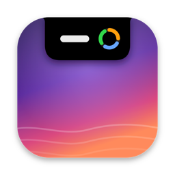

# Islet

**Your MacBook's notch, finally pulling its weight.**

Islet turns the notch into a home for small, glanceable tools. Every screen is a plugin, and a simple one takes a few lines of SwiftUI.

<a href="#getting-started"></a>
<a href="https://www.swift.org"></a>
<a href="#build-your-own-plugin"></a>

[Build a plugin](#build-your-own-plugin) · [Built-in plugins](#built-in-plugins) · [Getting started](#getting-started) · [Architecture](#architecture) · [FAQ](#faq)

<br>

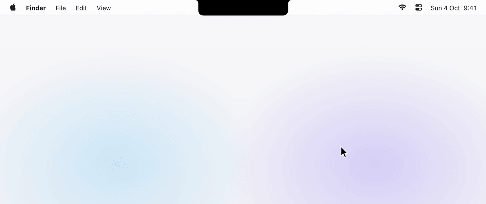

</div>

<br>

## Why Islet?

- **Everything is a plugin.** The built-in screens use the same public API as yours.
- **One class and a SwiftUI view.** Islet handles the notch shape, hover, animations, displays and settings.
- **Useful out of the box.** Nine built-in plugins, from a control centre for coding agents to a music player.

<br>

## Build your own plugin

This is a complete clock for your notch:

```swift
import IsletCore
import SwiftUI

@MainActor
public final class ClockPlugin: IsletPlugin {
    public static let manifest = PluginManifest(
        id: "com.example.clock",
        displayName: "Clock",
        systemImage: "clock"
    )

    private let context: PluginContext

    public init(context: PluginContext) {
        self.context = context
    }

    public func activate() async throws {
        context.contentSize = CGSize(width: 320, height: 120)
    }

    public func makeScreen() -> AnyView {
        AnyView(
            TimelineView(.periodic(from: .now, by: 1)) { timeline in
                Text(timeline.date, style: .time)
                    .font(.system(size: 44, weight: .semibold, design: .rounded))
                    .frame(maxWidth: .infinity, maxHeight: .infinity)
            }
        )
    }
}
```

Through its `PluginContext`, a plugin can:

| | |
|---|---|
| **`contentSize`** | Resize the notch to fit its content. |
| **`pillStatus`**, **`announce(_:)`** | Show an icon, ring, text or artwork in the collapsed notch, or flash a short message below it. |
| **`settings`**, **`makeSettingsView()`** | Persist preferences and add a tab to the settings window. |
| **`acceptedDropTypes`** | Accept files, links, text or images dragged onto the notch. |
| **`derive`**, **`observe`**, **`isScreenVisible`** | Keep size and pill in sync with its model, and pause work while hidden. |
| **`storageDirectory`**, **`logger`** | Store data in its own folder and log through its own `os.Logger`. |

To start one, run the `/new-plugin` skill in Claude Code, copy `Plugins/HelloPlugin`, or follow the [getting started guide](docs/plugins/getting-started.md). The [plugin developer guide](docs/plugins/README.md) covers the full API.

<br>

## Built-in plugins

They are ordinary plugins on the same API as yours. Switch off the ones you don't need under **Settings › Plugins**.

### Agents

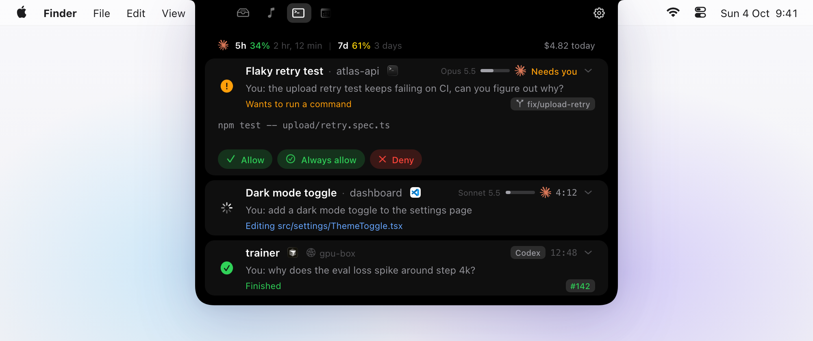

Every **Claude Code** and **Codex** session, live:

- Allow or deny permission requests and answer questions from the notch.
- See each session's state, current tool call, model, context use, cost, branch and pull request.
- Jump to the session's terminal tab, tmux pane or editor window in one click.
- Follow sessions on remote machines over SSH, and your Claude usage limits.

### Media

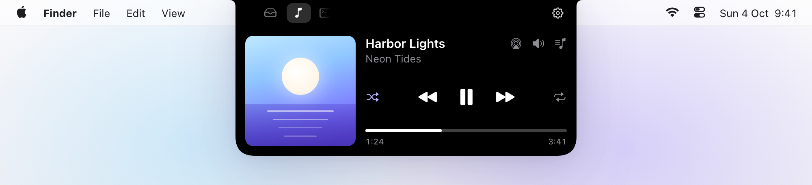

Controls **Spotify** and **Apple Music**, with volume, output devices and Apple Music playlists. The controls take their tint from the artwork.

### Shelf

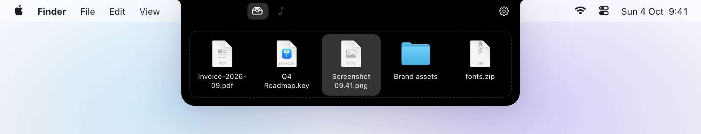

Drop files, text, links or images on the notch to park them, then drag them into any app, preview them with Quick Look or share them.

### Calendar

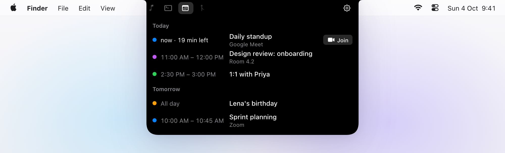

Today's and tomorrow's events, a **Join** button for Zoom, Meet, Teams and Webex, and a countdown to the next one in the collapsed notch.

### GitHub

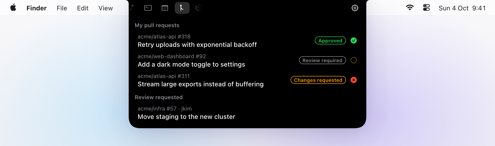

Your pull requests and review requests with their review and CI status, and an announcement when checks fail or someone approves. Uses the [GitHub CLI](https://cli.github.com).

### Timer

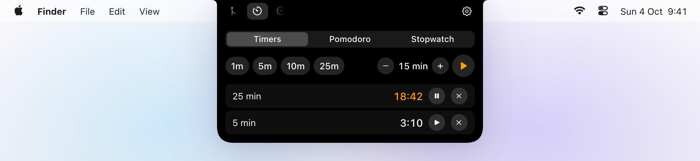

Countdown timers, a Pomodoro mode and a stopwatch. The soonest timer shows as a ring in the collapsed notch.

### System

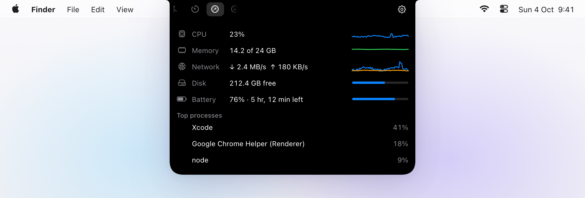

CPU, memory, network, disk and battery with the top processes. The collapsed notch only speaks up when something needs attention.

### Downloads

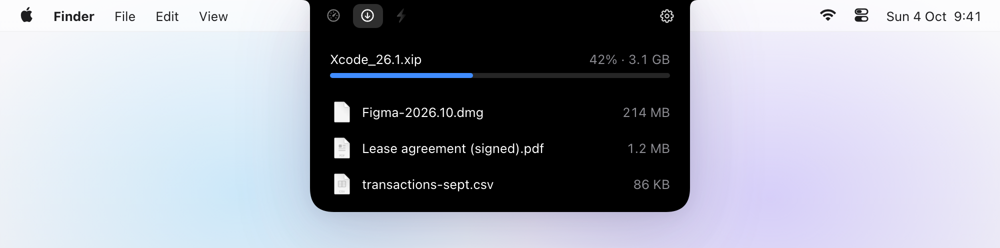

Progress of downloads in your Downloads folder, and the most recent files ready to drag into any app.

### Scripts

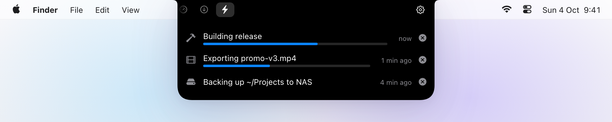

Put your own scripts in the notch with the `islet` command-line tool (install it under **Settings › Scripts**) or a local HTTP API:

```sh
islet run backup -- rsync -a ~/Projects /Volumes/Backup
islet progress export 40% "Exporting promo-v3.mp4"
islet announce "Deploy finished" --symbol checkmark
```

<br>

## The notch

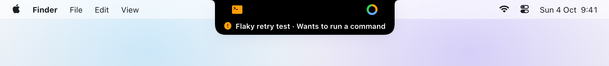

While collapsed, the notch shows a small pill next to the camera with whatever matters most right now. It opens on hover, click or a keyboard shortcut, works on every display (with a virtual notch where there is none), and the plugins can be reordered in the settings.

<br>

## Getting started

**Requirements:** macOS 15 or later, Xcode 26 or later and [XcodeGen](https://github.com/yonaskolb/XcodeGen). No Apple Developer account is needed.

```sh
brew install xcodegen
git clone https://github.com/MariSchn/Islet.git
cd Islet
xcodegen generate
xcodebuild -project Islet.xcodeproj -scheme Islet -configuration Release -derivedDataPath DerivedData build
open DerivedData/Build/Products/Release/Islet.app
```

Copy `Islet.app` to `/Applications` to keep it around. Some plugins need a one-time setup:

- **Agents:** press **Install** next to the hooks in **Settings › Agents** and restart running sessions. For usage limits, also install the status line integration there.
- **Media, Calendar, Downloads:** allow access when macOS asks.
- **GitHub:** `brew install gh` and `gh auth login`.

<br>

## Architecture

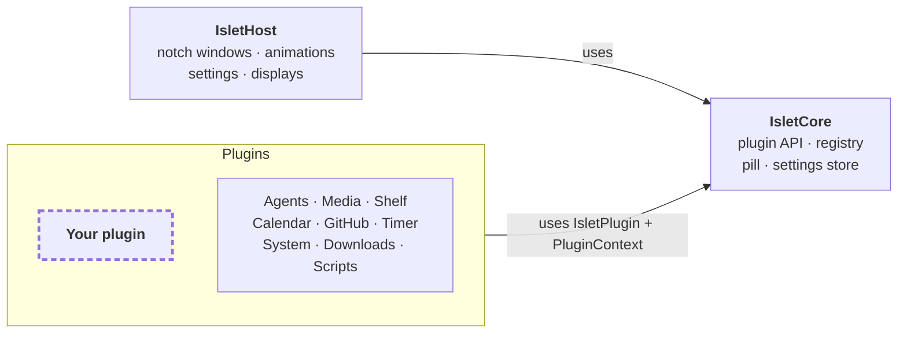

Plugins live in `Plugins/`, one Swift package each, and only import `IsletCore`. `IsletHost` owns the windows and animations and is the only package that uses private macOS frameworks.

<br>

## Development

The Xcode project is generated from `project.yml` and not checked in. Each package can be tested on its own:

```sh
swift test --package-path Packages/IsletCore
swift test --package-path Plugins/AgentsPlugin
```

<br>

## FAQ

<details>
<summary><b>Does it work on a Mac without a notch?</b></summary>
<br>
Yes. Islet draws a virtual notch at the top centre of displays without one.
</details>

<details>
<summary><b>Will the agent hooks slow down my agent?</b></summary>
<br>
No. The hook only forwards events to Islet and gives up within a second if Islet isn't running. Only permission requests wait for your answer.
</details>

<details>
<summary><b>Why are my Claude usage limits not showing?</b></summary>
<br>
Claude Code only reports them for Pro and Max plans, and only to its status line. Install the status line integration under <b>Settings › Agents</b> and turn on <b>Show Claude usage limits</b>.
</details>

<br>

<div align="center">
<sub>Made for the notch you already have. What will you put in yours?</sub>
</div>
