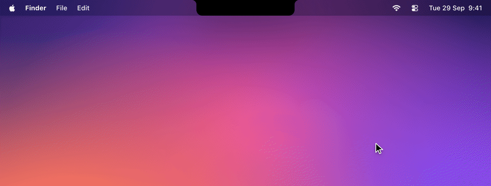
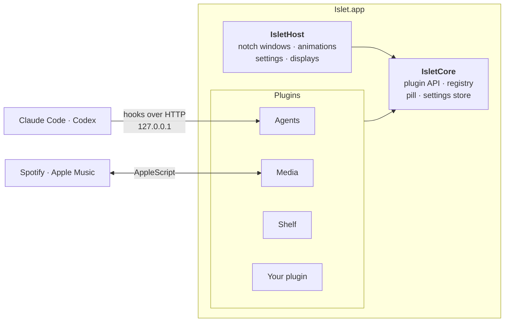

<div align="center">


# Islet

**Your MacBook's notch, finally pulling its weight.**

A dynamic island for macOS that keeps an eye on your AI coding agents, controls your music and holds your files, and runs any screen you build for it in SwiftUI.

<a href="#-getting-started"></a>
<a href="https://www.swift.org"></a>
<a href="#-agents"></a>
<a href="#-private-by-design"></a>

[Features](#-features) · [Getting started](#-getting-started) · [Build a plugin](#-build-your-own-plugin) · [Architecture](#-architecture) · [FAQ](#-faq)

<br>



</div>

<br>

## Why Islet?

The notch sits in the most valuable spot on your screen and does nothing. Islet turns it into a quiet status bar that grows into a full panel when you hover over it:

- 🤖 **Stop babysitting terminals.** See every Claude Code and Codex session at a glance, approve permission requests from the notch and jump straight to the right terminal tab.
- 🎧 **Music without switching apps.** Play, skip, seek and browse playlists for Spotify and Apple Music.
- 📥 **A shelf for files in transit.** Drop files on the notch, drag them out later wherever you need them.
- 🧩 **Built as a plugin host.** Every screen, including the built-in ones, is a plugin written against a small SwiftUI API. Adding your own takes one class.

<br>

## ✨ Features

### 🤖 Agents


Mission control for your coding agents. Islet installs lightweight hooks for **Claude Code** and **Codex** and shows every session live:

- **Approve without leaving your flow.** Permission requests and agent questions show up in the notch with **Allow** / **Deny** or the answer options.
- **Know what each agent is doing.** Working, needs you, finished or failed, with the current tool call, your last prompt, a turn timer and the recent tool calls when you expand a row.
- **Jump to the session.** One click brings the exact tab to the front in Terminal and iTerm2, the project window in VS Code, Cursor and VSCodium, and Ghostty or WezTerm when that's where the agent runs.
- **Remote machines.** Sessions on servers you reach over SSH show up too, labelled with the host name and flagged when the tunnel goes quiet.
- **Claude usage limits.** Your 5-hour and weekly quota and when each resets, read from Claude Code's own status line. Islet never reads your credentials or calls any API.
- **Alerts your way.** A sound, a macOS notification or a short announcement in the notch when an agent needs you or finishes.

### 🎧 Media


- Controls **Spotify** and **Apple Music**: play/pause, skip, shuffle, repeat and a seekable timeline.
- Browse your playlists and start one right from the notch.
- The controls pick up their tint from the album artwork.
- Optionally shows the current artwork in the collapsed notch.

### 📥 Shelf


- Drag files onto the notch and Islet switches to the Shelf automatically.
- Drag them back out into any app, open them or reveal them in Finder.
- The Shelf survives restarts and dims files that were moved or deleted.

### 💊 The pill


While collapsed, the notch grows a small pill next to the camera housing: a status ring counting sessions that need you, are working or are done, the current album artwork, or whatever your own plugin wants to say. Anything urgent, like a permission request, always gets through.

### 🪄 Feels like part of macOS

- **Hover to open**, move away to close, with an adjustable delay. Swipe with two fingers to switch plugins.
- **Spring animations** with adjustable bounce, or a plain ease-out curve if you prefer calm.
- **Three sizes** for the expanded notch.
- **Every display.** The built-in screen, the primary display, all displays or a specific monitor. Displays without a notch get a virtual one.
- **Menu bar icon** optional, **open at login** optional, and a settings window with a tab for each plugin.

<br>

## 🔒 Private by design

| | |
|---|---|
| 🏠 **Local only** | The agent hooks talk to Islet over `127.0.0.1`. Nothing leaves your Mac. |
| 🔑 **No credentials** | Islet never touches your Keychain or API keys. Usage limits come from the data Claude Code already hands to its status line. |
| 📜 **Readable hooks** | The hooks are a short shell script in `~/.claude` / `~/.codex` that you can read, and remove from the settings at any time. |
| 🎛️ **Opt-in** | Music control asks macOS for permission first; the agent hooks, macOS notifications and the status line integration are off until you turn them on. |

<br>

## 🚀 Getting started

**Requirements:** macOS 15 Sequoia or later, Xcode 16+ and [XcodeGen](https://github.com/yonaskolb/XcodeGen).

```sh
brew install xcodegen
git clone https://github.com/MariSchn/Islet.git
cd Islet
xcodegen generate
xcodebuild -project Islet.xcodeproj -scheme Islet -configuration Release -derivedDataPath DerivedData build
open DerivedData/Build/Products/Release/Islet.app
```

Or open `Islet.xcodeproj` in Xcode and press <kbd>⌘</kbd> <kbd>R</kbd>.

**First launch**

1. Hover over the notch. That's it, Islet is running.
2. For agents, open **Settings › Agents › Install Hooks**, then restart any sessions that were already running. Codex additionally needs its hooks feature enabled in `~/.codex/config.toml` and the hooks trusted once via `/hooks`.
3. For usage limits and live session names, install the **status line** integration in the same tab. Your existing status line keeps working.
4. For music, press play in Spotify or Apple Music and allow Islet to control it when macOS asks.

<br>

## 🧩 Build your own plugin

A plugin is one class plus a SwiftUI view. This is a complete clock screen:

```swift
import IsletCore
import SwiftUI

@MainActor
public final class ClockPlugin: IsletPlugin {
    public static let manifest = PluginManifest(id: "com.example.clock", displayName: "Clock", systemImage: "clock")

    private let context: PluginContext

    public init(context: PluginContext) {
        self.context = context
    }

    public func activate() async throws {
        context.contentSize = CGSize(width: 320, height: 120)
    }

    public func makeScreen() -> AnyView {
        AnyView(
            TimelineView(.periodic(from: .now, by: 1)) { timeline in
                Text(timeline.date, style: .time)
                    .font(.system(size: 44, weight: .semibold, design: .rounded))
                    .frame(maxWidth: .infinity, maxHeight: .infinity)
            }
        )
    }
}
```

Through the `PluginContext` a plugin can resize the notch, put a status in the collapsed pill, accept file drops, store settings and add its own settings tab, all without touching the host.

📖 The **[plugin developer guide](docs/plugins/README.md)** has a step-by-step walkthrough, the API reference and notes on sizing, the pill, settings, resources, concurrency and testing.

<br>

## 🏗 Architecture



- **`Packages/IsletCore`** is the only thing a plugin imports: the `IsletPlugin` protocol, `PluginContext`, the registry and the pill types.
- **`Packages/IsletHost`** owns the notch windows, the settings window and the animations. It is the only package that uses private macOS frameworks.
- **`Plugins/`** contains the built-in plugins, each its own Swift package depending only on `IsletCore`. They are linked into the app and listed in `AppDelegate.builtInPlugins` (`App/AppDelegate.swift`).

<br>

## 🛠 Development

The Xcode project is generated from `project.yml` with XcodeGen and is not checked in. Each package can be tested without Xcode:

```sh
swift test --package-path Packages/IsletCore
swift test --package-path Packages/IsletHost
swift test --package-path Plugins/AgentsPlugin
```

GitHub Actions builds the app and runs the tests of the whole `Islet` scheme on every pull request (`.github/workflows/ci.yml`).

<br>

## ❓ FAQ

<details>
<summary><b>Does it work on a Mac without a notch?</b></summary>
<br>
Yes. On displays without a notch, Islet draws a virtual one at the top centre of the screen, and you can pick which displays show it.
</details>

<details>
<summary><b>Will the hooks slow down or break my agent?</b></summary>
<br>
No. The hook script only forwards each event to Islet on your machine. If Islet is not running, it gives up within a second and the agent carries on exactly as before. Only permission requests wait for your answer in the notch.
</details>

<details>
<summary><b>Why are my usage limits not showing?</b></summary>
<br>
Claude Code only reports rate limits for Pro and Max plans, and only to its status line. Install the status line integration under <b>Settings › Agents</b> and send a message in Claude Code; the bar appears with the next update.
</details>

<details>
<summary><b>Can I use agents running on another machine?</b></summary>
<br>
Yes. Forward Islet's port over SSH (the exact <code>~/.ssh/config</code> line is in <b>Settings › Agents › Remote machines</b>) and run the install command shown there once on the remote machine.
</details>

<br>

<div align="center">
<sub>Made for the notch you already have.</sub>
</div>
