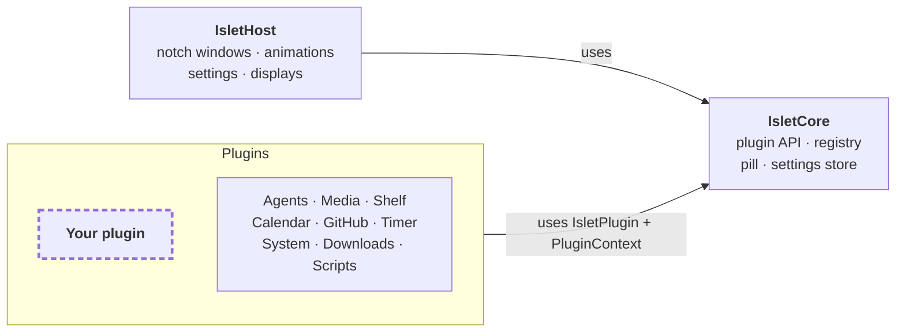

<div align="center">


# Islet

**Your MacBook's notch, finally pulling its weight.**

Islet turns the notch into a home for small, glanceable tools: your coding agents, music, files, calendar and more.<br>Every screen is a plugin, and you can write your own in a few lines of SwiftUI.

<a href="#install"><b>Build from source</b></a>

<sub>Free and open source · macOS 15 Sequoia or later · works on Macs without a notch too</sub>

<br>


</div>

<br>

## Why Islet?

- **Answer your coding agents from the notch.** Allow a command, answer a question or jump to the right terminal tab without leaving what you're doing.
- **Useful out of the box.** Nine built-in plugins, from music controls to a file shelf, calendar, timers and system stats.
- **Everything is a plugin.** The built-in screens use the same public API as yours, and Islet handles the notch shape, hover, animations, displays and settings.
- **Private by design.** No account, no analytics. Your data stays on your Mac.

<br>

## Install

There are no prebuilt releases yet, so build Islet from source. You need macOS 15 or later, Xcode 26 or later and [XcodeGen](https://github.com/yonaskolb/XcodeGen). No Apple Developer account is needed.

1. Build Islet and copy it into Applications:

   ```sh
   brew install xcodegen
   git clone https://github.com/MariSchn/Islet.git
   cd Islet
   xcodegen generate
   xcodebuild -project Islet.xcodeproj -scheme Islet -configuration Release -derivedDataPath DerivedData build
   cp -R DerivedData/Build/Products/Release/Islet.app /Applications/
   ```

2. Open Islet. The settings window opens on first launch; turn on **Open Islet at login** there.
3. Hover over the notch to open it. To update, quit Islet, run `git pull` and the last three commands again.

Some plugins need a one-time setup:

| Plugin | Setup |
| --- | --- |
| Agents | Under **Settings › Agents**, click **Connect** next to Claude Code, Codex or Antigravity and restart running sessions. For Claude usage limits, also connect the status line. |
| Media, Calendar, Downloads | Allow access when macOS asks. |
| GitHub | Install the [GitHub CLI](https://cli.github.com) with `brew install gh` and run `gh auth login`. |
| Scripts | Install the `islet` command under **Settings › Scripts**. |

<br>

## Built-in plugins

They are ordinary plugins on the same API as yours. Turn off the ones you don't need under **Settings › Plugins**, and drag them into your favourite order.

### Agents


Every **Claude Code**, **Codex** and **Antigravity** session, live:

- Allow or deny permission requests and answer questions from the notch.
- See each session's state, current tool call, model, context use, cost, branch and pull request.
- Jump to the session's terminal tab, tmux pane or editor window in one click.
- Follow sessions on remote machines over SSH, and keep an eye on your Claude usage limits.

### Media


Controls **Spotify** and **Apple Music**, with volume, output devices and Apple Music playlists. The controls take their tint from the artwork.

### Shelf


Drop files, text, links or images on the notch to park them, then drag them into any app, preview them with Quick Look or share them.

### Calendar


Today's and tomorrow's events, a **Join** button for Zoom, Meet, Teams and Webex, and a countdown to the next one in the collapsed notch.

### GitHub


Your pull requests and review requests with their review and CI status, and an announcement when checks fail or someone approves. Uses the [GitHub CLI](https://cli.github.com).

### Timer


Countdown timers, a Pomodoro mode and a stopwatch. The soonest timer shows as a ring in the collapsed notch.

### System


CPU, memory, network, disk and battery with your busiest processes. The collapsed notch only speaks up when something needs attention.

### Downloads


Progress of downloads in your Downloads folder, and the most recent files ready to drag into any app.

### Scripts


Put your own scripts in the notch with the `islet` command-line tool or a local HTTP API:

```sh
islet run backup -- rsync -a ~/Projects /Volumes/Backup
islet progress export 40% "Exporting promo-v3.mp4"
islet announce "Deploy finished" --symbol checkmark
```

<br>

## The notch


While collapsed, the notch shows a small pill next to the camera with whatever matters most right now. It opens on hover, click or a keyboard shortcut, works on every display (with a virtual notch where there is none), and hides while your Mac is locked.

<br>

## Build your own plugin

This is a complete clock for your notch:

```swift
import IsletCore
import SwiftUI

@MainActor
public final class ClockPlugin: IsletPlugin {
    public static let manifest = PluginManifest(
        id: "com.example.clock",
        displayName: "Clock",
        systemImage: "clock"
    )

    private let context: PluginContext

    public init(context: PluginContext) {
        self.context = context
    }

    public func activate() async throws {
        context.contentSize = CGSize(width: 320, height: 120)
    }

    public func makeScreen() -> AnyView {
        AnyView(
            TimelineView(.periodic(from: .now, by: 1)) { timeline in
                Text(timeline.date, style: .time)
                    .font(.system(size: 44, weight: .semibold, design: .rounded))
                    .frame(maxWidth: .infinity, maxHeight: .infinity)
            }
        )
    }
}
```

A plugin can also:

| | |
|---|---|
| **`context.contentSize`** | Resize the notch to fit its content. |
| **`context.pillStatus`**, **`context.announce(_:)`** | Show an icon, ring, text or artwork in the collapsed notch, or flash a short message below it. |
| **`context.settings`**, **`makeSettingsView()`** | Persist preferences and add its own settings page. |
| **`acceptedDropTypes`** | Accept files, links, text or images dragged onto the notch. |
| **`context.derive`**, **`context.observe`**, **`context.isScreenVisible`** | Keep size and pill in sync with its model, and pause work while hidden. |
| **`context.storageDirectory`**, **`context.logger`** | Store data in its own folder and log through its own `os.Logger`. |

To start one, run the `/new-plugin` skill in Claude Code or follow the [getting started guide](docs/plugins/getting-started.md). The [plugin developer guide](docs/plugins/README.md) covers the full API. Plugins are compiled into the app, so add yours in a fork and [build from source](#install).

<br>

## Privacy

Islet has no account and collects no analytics. It connects to the internet only to load Spotify artwork; the GitHub plugin asks the GitHub CLI for your pull requests.

To follow your agents, Islet adds a small hook script to `~/.claude`, `~/.codex` or `~/.gemini` that forwards session events to Islet on your Mac (`127.0.0.1`). The optional status line connection wraps your Claude Code status line command and keeps showing your own status line. Both are removed again with **Disconnect**. See [SECURITY.md](SECURITY.md) for details.

<br>

## Uninstall

1. Under **Settings › Agents**, disconnect your agents and the status line. This restores your previous status line.
2. Under **Settings › Scripts**, remove the `islet` command if you installed it.
3. Quit Islet and move it to the Trash.
4. To remove its data too: `rm -rf ~/Library/Application\ Support/Islet` and `defaults delete com.marischn.Islet`.

<br>

## Architecture



Plugins live in `Plugins/`, one Swift package each, and only import `IsletCore`. `IsletHost` owns the windows and animations and is the only package that uses private macOS frameworks.

<br>

## FAQ

<details>
<summary><b>Does it work on a Mac without a notch?</b></summary>
<br>
Yes. Islet draws a virtual notch at the top centre of displays without one, including external displays.
</details>

<details>
<summary><b>Will the agent hooks slow down my agent?</b></summary>
<br>
No. The hook only forwards events to Islet and gives up within a second if Islet isn't running. Only permission requests wait for your answer, and you can still answer them in the terminal.
</details>

<details>
<summary><b>Why are my Claude usage limits not showing?</b></summary>
<br>
Claude Code only reports them for Pro and Max plans, and only to its status line. Connect the status line under <b>Settings › Agents</b> and turn on <b>Show Claude usage limits</b>.
</details>

<details>
<summary><b>Can I follow agents running on another machine?</b></summary>
<br>
Yes, over SSH. <b>Settings › Agents › Remote Machines</b> has the line for your SSH config and a one-time install command for the remote machine.
</details>

<br>

## Contributing

Bug reports, ideas and pull requests are welcome. Start with [CONTRIBUTING.md](CONTRIBUTING.md), and report security issues privately as described in [SECURITY.md](SECURITY.md).

## License

Islet is released under the [MIT License](LICENSE). It includes [Sparkle](https://sparkle-project.org) for updates; see [ACKNOWLEDGEMENTS.md](ACKNOWLEDGEMENTS.md).
